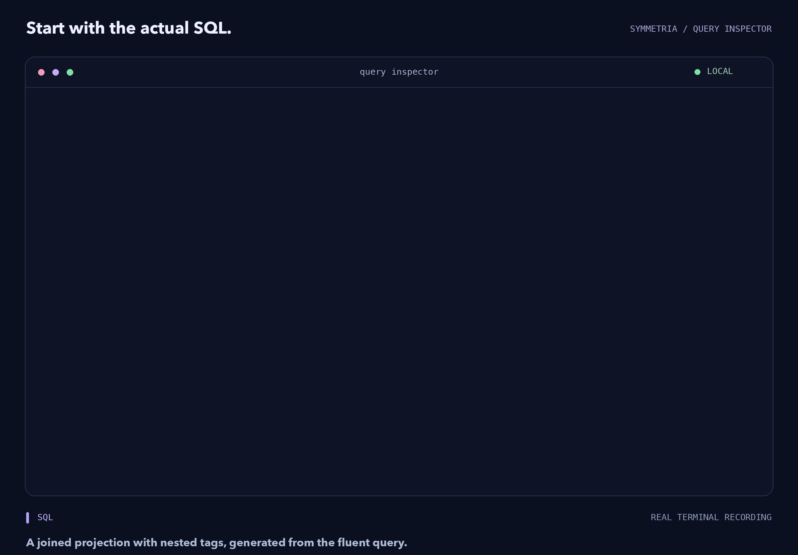
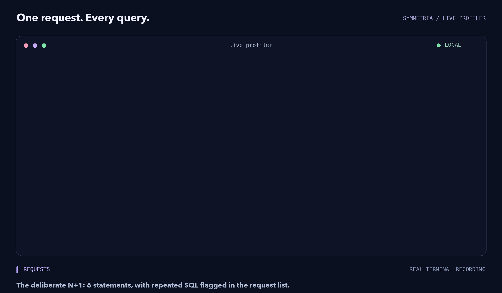
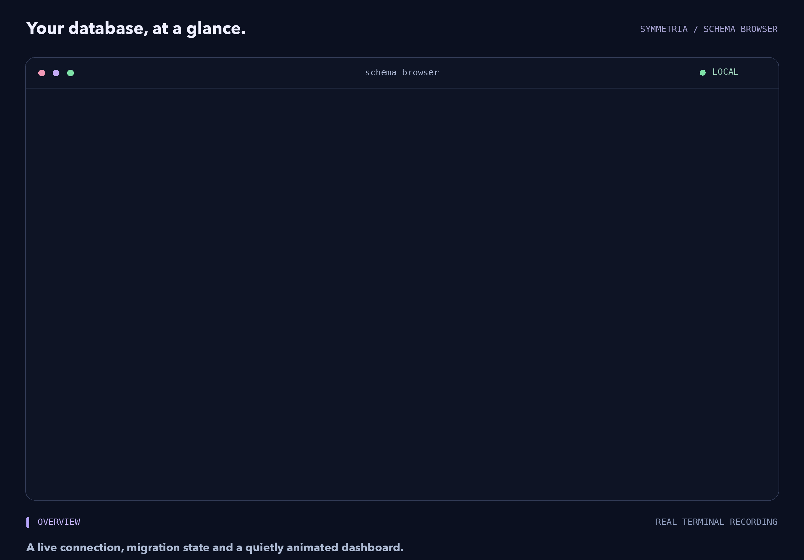
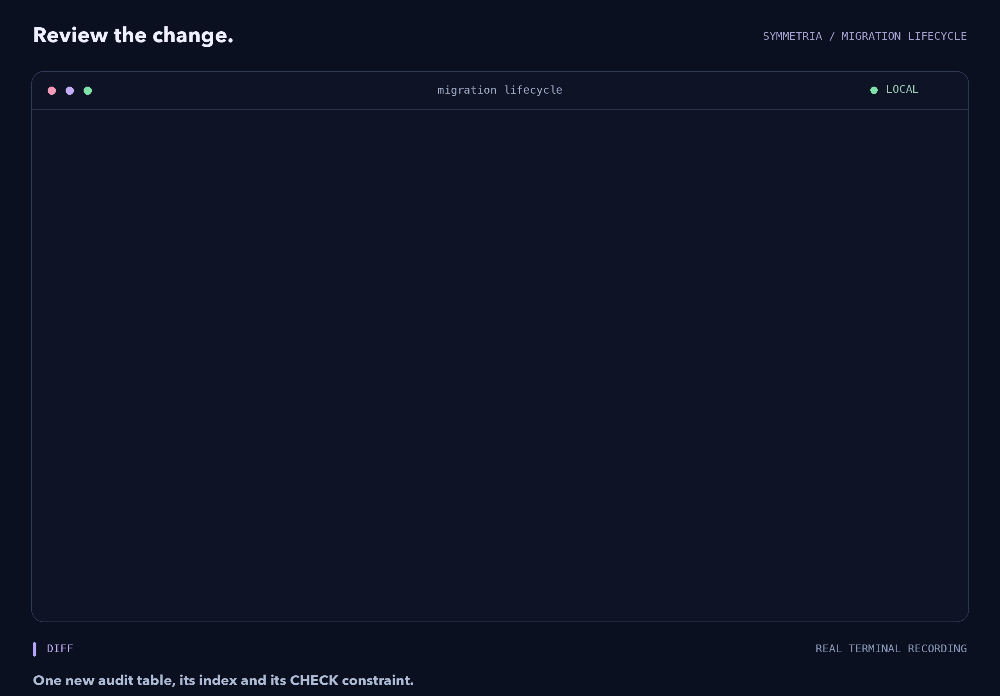
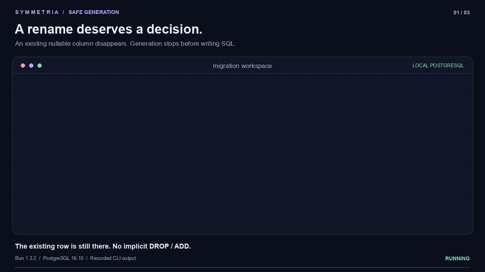
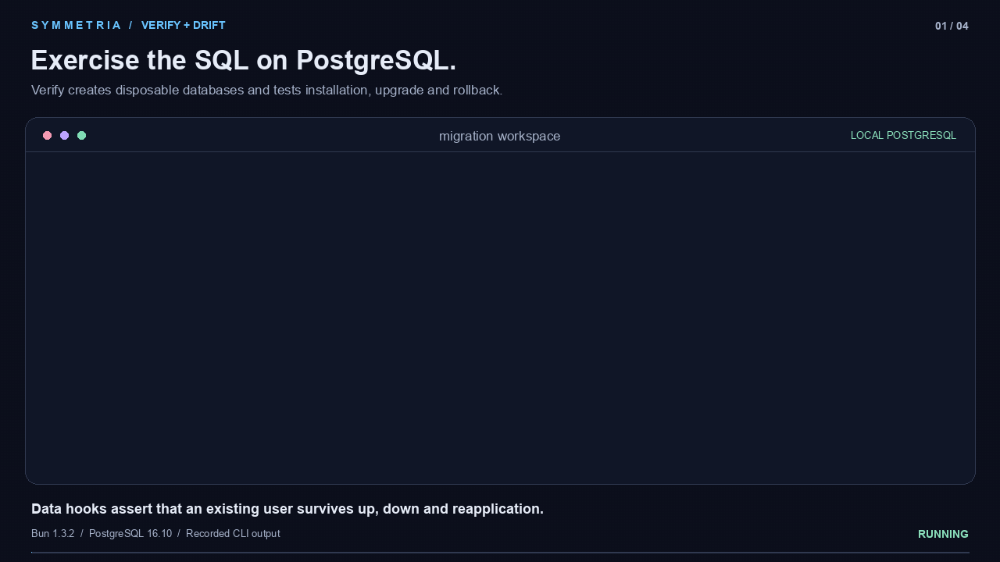
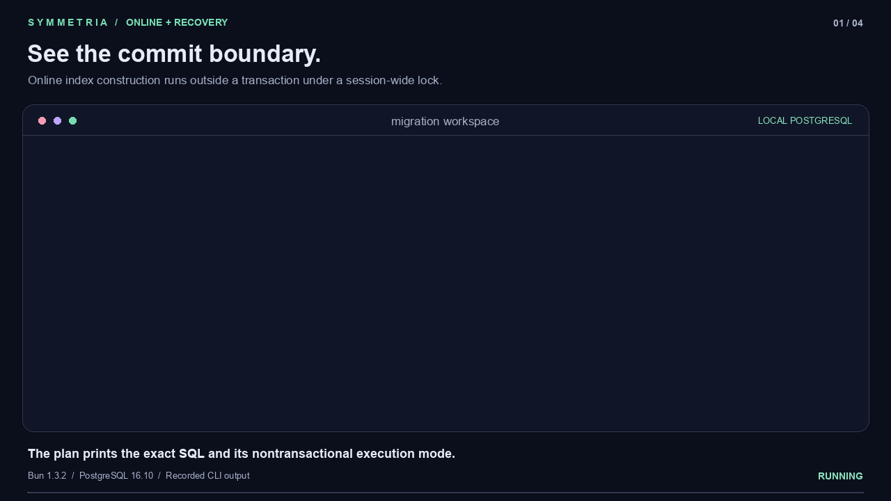
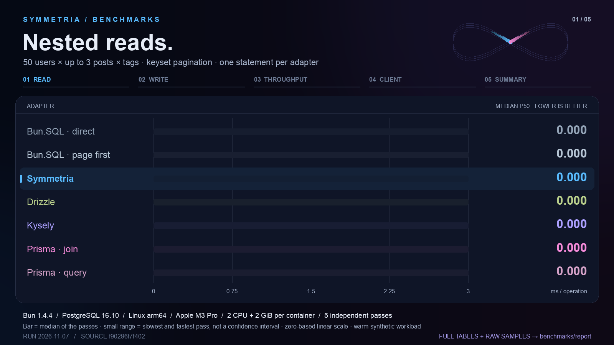

<p align="center">
  
</p>

<h1 align="center">Symmetria</h1>

<p align="center">
  <strong>Select the shape. PostgreSQL does the work.</strong><br>
  The result you describe in TypeScript becomes exactly one SQL statement, typed to the field, at the speed of hand-written SQL.<br>
  <strong>Node.js · Bun · TypeScript · ESM</strong>
</p>

<p align="center">
  <a href="#get-started">Get started</a> ·
  <a href="docs/guide.md">Guide</a> ·
  <a href="docs/reference.md">API reference</a> ·
  <a href="examples/README.md">Examples</a> ·
  <a href="#performance">Benchmarks</a>
</p>

```ts
const authors = await db.users(
  ({ name, posts }) => ({
    name,
    posts: posts(
      ({ title, views }) => ({
        title,
        views,
      }),
      {
        where: ({ published }) => published.is(true),
        orderBy: ({ id }) => id.descending,
        limit: 3,
      },
    ),
  }),
  {
    orderBy: ({ id }) => id.ascending,
    limit: 20,
  },
);
// { name: string; posts: { title: string; views: bigint }[] }[]
```

One SQL statement: twenty authors, each with their three latest published posts.
The projection describes the result, the options pick the rows, and the type is
inferred all the way down. `bigint` stays bigint, `numeric` stays a decimal
string, timestamps become Dates, nested JSON included.

## Why Symmetria

**The shape is the query.** You write the result you want; Symmetria compiles it
into one SQL statement, however deep the nesting, with per-parent filters,
limits and aggregates. There is no N+1, no data loader and no ORM runtime
between your code and PostgreSQL: the nested read above runs within 1% of a
hand-written `LATERAL` query and about twice as fast as Prisma's join strategy
([benchmarks](#performance)).

**The type is the result.** Every field, nullable join, `bigint`, decimal and
nested collection is inferred from the projection, so the editor already knows
what PostgreSQL will return. Mistakes name the table and column and suggest the
closest match.

**The schema is the source of truth.** One declaration drives queries,
migrations, drift detection and `pull` for databases that already exist,
including keys by unique columns, relations without foreign keys, full-text
search and pgvector.

**Nothing is hidden.** `inspect()` shows the SQL, the parameters and the plan;
the profiler shows where each millisecond went.

## Relationships become SQL

```ts
const feed = db.posts(
  ({ title, author }) => ({
    title,
    author: author.name,
  }),
  {
    where: ({ author }) => author.name.ilike("A%"),
    limit: 10,
  },
);

const { sql, parameters } = feed.toSQL();
```

`author.name` adds its JOIN; required references use INNER JOIN, optional and
reverse paths use LEFT JOIN. Nested collections become correlated subqueries, so
relation loading stays in one statement.

## Compose and reuse

```ts
const userCard = db.users.shape(({ name, posts }) => ({
  name,
  totalViews: posts.sum.views,
}));

const authors = db.users(userCard, { limit: 20 });
const feed = db.posts(({ title, author }) => ({
  title,
  author: author(userCard),
}));

const latest = prepare({ authorId: int, size: int }, (p) =>
  db.posts(
    ({ title }) => ({
      title,
    }),
    {
      where: ({ authorId }) => authorId.is(p.authorId),
      limit: p.size,
    },
  ),
);
const posts = await latest({ authorId: 7, size: 3 });
```

Projections are reusable across tables, relations and `RETURNING`. Queries are
immutable; prepared queries compile once and bind fresh values on each call.

## See what actually runs

`await feed.inspect()` opens SQL, parameters, results and the EXPLAIN plan in
your terminal. `createProfiler()` records build, compile, database and decode
timings per request for `symmetria profile`, `symmetria inspect` browses the
schema and `symmetria graph` draws it as a Mermaid diagram. Schema and query
mistakes name the table and column and suggest the closest known name.

<picture>
  <source media="(prefers-reduced-motion: reduce)" srcset="docs/assets/query-inspector.png">
  
</picture>

<picture>
  <source media="(prefers-reduced-motion: reduce)" srcset="docs/assets/profiler.png">
  
</picture>

<picture>
  <source media="(prefers-reduced-motion: reduce)" srcset="docs/assets/kit-schema.png">
  
</picture>

## Get started

Requires PostgreSQL 14+ and Node.js 24.11+ or Bun 1.4.4+.

```sh
npm install symmetria pg && npm install -D symmetria-kit   # or: bun add symmetria && bun add -d symmetria-kit
npx --package symmetria-kit symmetria init
npx --package symmetria-kit symmetria pull schema.ts   # existing database → schema module
```

```ts
// schema.ts
import { schema, table, int, text, bool, bigint } from "symmetria";

const users = table({
  id: int.auto,
  name: text,
  email: text.unique,
});

const posts = table({
  id: int.auto,
  author: users.index, // foreign key, index, post.author and user.posts
  title: text,
  views: bigint.default(0n),
  published: bool.default(false),
});

export const appSchema = schema({ users, posts });
```

```ts
// database.ts
import { createDatabase } from "symmetria";
import { postgres } from "symmetria/pg"; // or "symmetria/bun"
import { appSchema } from "./schema.ts";

export const db = createDatabase({
  schema: appSchema,
  driver: postgres({ url: process.env.DATABASE_URL! }),
});
```

Generate, review and apply the migration:

```sh
npx --package symmetria-kit symmetria generate initial
npx --package symmetria-kit symmetria migrate
```

<picture>
  <source media="(prefers-reduced-motion: reduce)" srcset="docs/assets/kit-migrations.png">
  
</picture>

## Migrations you can read

Real CLI output recorded against PostgreSQL; playback is paced for reading.

Renames need explicit hints, drops need `--allow-destructive`, and `lint` reads
the saved SQL:

<picture>
  <source media="(prefers-reduced-motion: reduce)" srcset="docs/assets/migration-safety.png">
  
</picture>

`verify` replays install, upgrade and rollback in disposable databases; `drift`
and `adopt` catch manual changes:

<picture>
  <source media="(prefers-reduced-motion: reduce)" srcset="docs/assets/migration-verification.png">
  
</picture>

Online DDL runs outside transactions; a failed step stays `incomplete` until
`repair` verifies the fix:

<picture>
  <source media="(prefers-reduced-motion: reduce)" srcset="docs/assets/migration-recovery.png">
  
</picture>

## Write with the same schema

```ts
await db.$transaction(async (tx) => {
  const author = await tx.users
    .insert({ name: "Ada", email: "ada@example.com" })
    .returning(({ id }) => [id]);

  await tx.posts.insert({ title: "Typed SQL", authorId: author.id });
});

await db.posts.byId(42).update(({ views }) => ({ views: views.plus(1n) }));

await db.users.by
  .email("ada@example.com")
  .update({ name: "Ada Lovelace" })
  .returning(({ id, name }) => ({ id, name }));
```

Typed `RETURNING`, upserts, atomic nested inserts, bulk chunking, savepoints,
and writes through unique lookups in one statement.
`$transaction(fn, { retries: 3 })` re-runs the callback after serialization
failures and deadlocks; `query.stream()` iterates any result through a
server-side cursor.

## Search, vectors and tables without keys

```ts
// Full-text search over a weighted document; the GIN index uses the same expression.
const document = searchDocument(
  { A: post.title, B: post.body },
  { language: "english" },
);
db.posts(
  ({ title, body }) => ({ title, snippet: body.searchHeadline("bun sql") }),
  {
    where: () => document.search("bun sql"),
    orderBy: () => document.searchRank("bun sql").descending,
  },
);

// pgvector: vector(n) columns, distance operators and HNSW / IVFFlat indexes.
db.documents(
  ({ content, embedding }) => ({
    content,
    distance: embedding.cosineDistance(query),
  }),
  {
    orderBy: ({ embedding }) => embedding.cosineDistance(query).ascending,
    limit: 5,
  },
);

// Legacy keys: reference a unique column, keep the old column name.
const comments = table({
  id: int.auto,
  author: users.by("email").column("author_email"),
});

// A relation without a foreign key: tables joined by a predicate.
const posts = table({ id: int.auto, title: text, authorName: text }).relations(
  (post, { to }) => ({
    author: to(users).one((user) => post.authorName.is(user.name)),
  }),
);
db.posts(({ title, author }) => ({ title, author: author.name })); // LEFT JOIN users ON ...
```

[Full-text search](docs/reference.md#full-text-search),
[vectors](docs/reference.md#vectors-pgvector) and
[relations without a foreign key](docs/reference.md#relations-without-a-foreign-key)
use the same shapes, paths and nested collections as everything else.

## Performance

Symmetria, Drizzle, Kysely, Prisma and hand-written SQL on the same PostgreSQL
dataset, correctness checked before timing;
[methodology and raw data](benchmarks/README.md).

<!-- benchmark:start -->
<a href="benchmarks/report/README.md">
  <picture>
    <source media="(prefers-reduced-motion: reduce)" srcset="docs/assets/benchmarks.png">
    
  </picture>
</a>

| Adapter                  | Point | List + JOIN | Nested keyset | INSERT 1 | INSERT 500 | UPDATE |
| ------------------------ | ----: | ----------: | ------------: | -------: | ---------: | -----: |
| Bun.SQL (direct LATERAL) | 0.011 |       0.082 |         0.990 |    0.492 |      4.145 |  0.512 |
| Bun.SQL (page first)     | 0.011 |       0.083 |         0.998 |    0.538 |      3.955 |  0.517 |
| Symmetria                | 0.018 |       0.110 |         1.003 |    0.526 |      4.614 |  0.546 |
| Drizzle                  | 0.021 |       0.137 |         1.235 |    0.535 |      7.325 |  0.536 |
| Kysely                   | 0.016 |       0.128 |         0.940 |    0.509 |      4.718 |  0.533 |
| Prisma (join)            | 0.041 |       0.111 |         2.113 |    0.555 |     19.542 |  0.592 |
| Prisma (query)           | 0.040 |       0.129 |         1.757 |    0.550 |     19.010 |  0.574 |

Median p50 per pass in ms per operation, lower is better; INSERT 500 is ms per
500-row batch. Bun 1.4.4 · PostgreSQL 16.10 · Linux/arm64 · Apple M3 Pro /
OrbStack · 5 independent passes · 2 CPUs / 2 GiB per container · durable
storage.

[Full results](benchmarks/report/README.md) ·
[Methodology and reproduction](benchmarks/README.md) ·
[Static chart](docs/assets/benchmarks.svg)
<!-- benchmark:end -->

[Guide](docs/guide.md) · [API reference](docs/reference.md) ·
[Advanced recipes](docs/advanced.md) · [Examples](examples/README.md) ·
[Contributing](CONTRIBUTING.md) · [Changelog](CHANGELOG.md) · [MIT](LICENSE)
