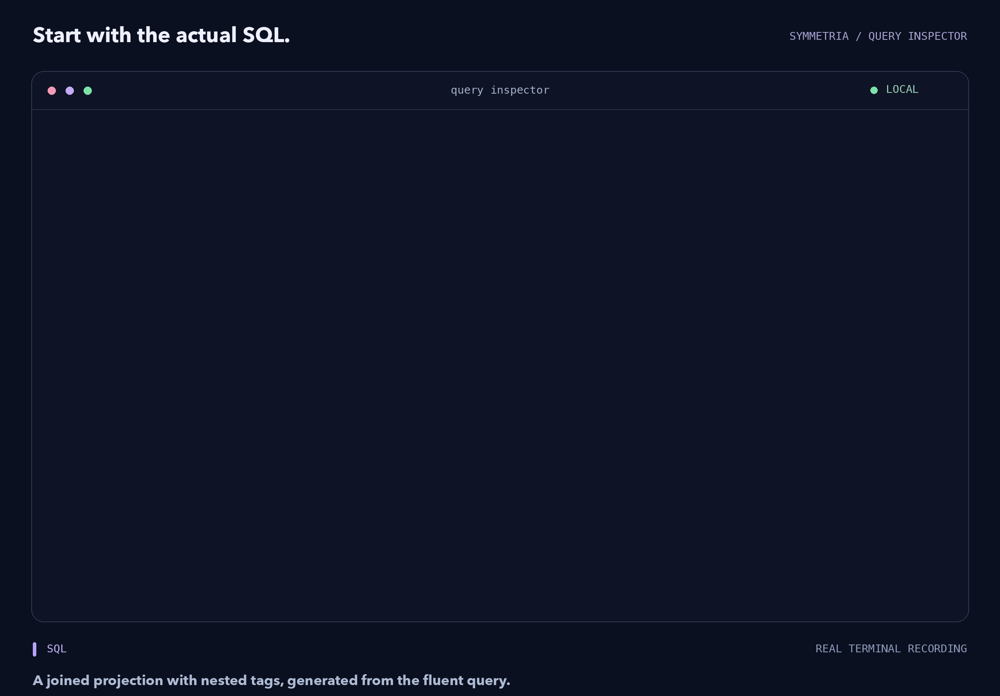
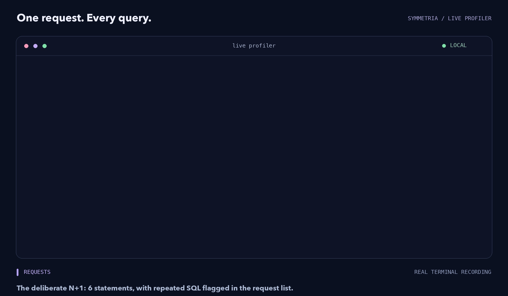
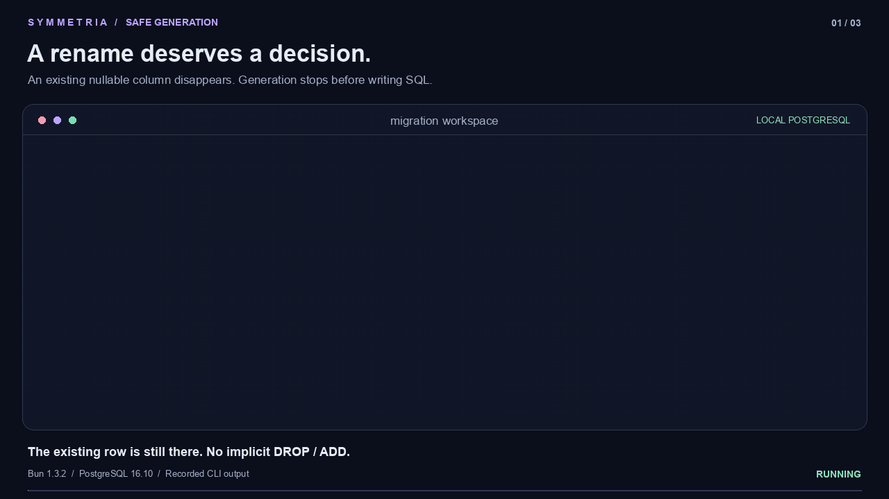
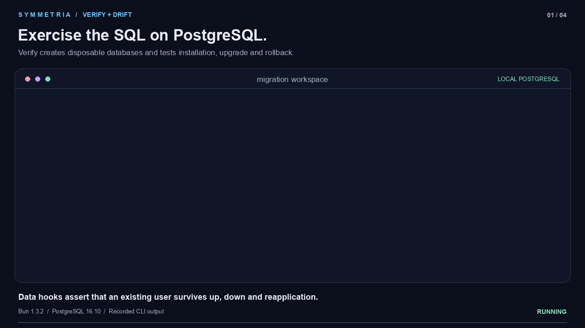
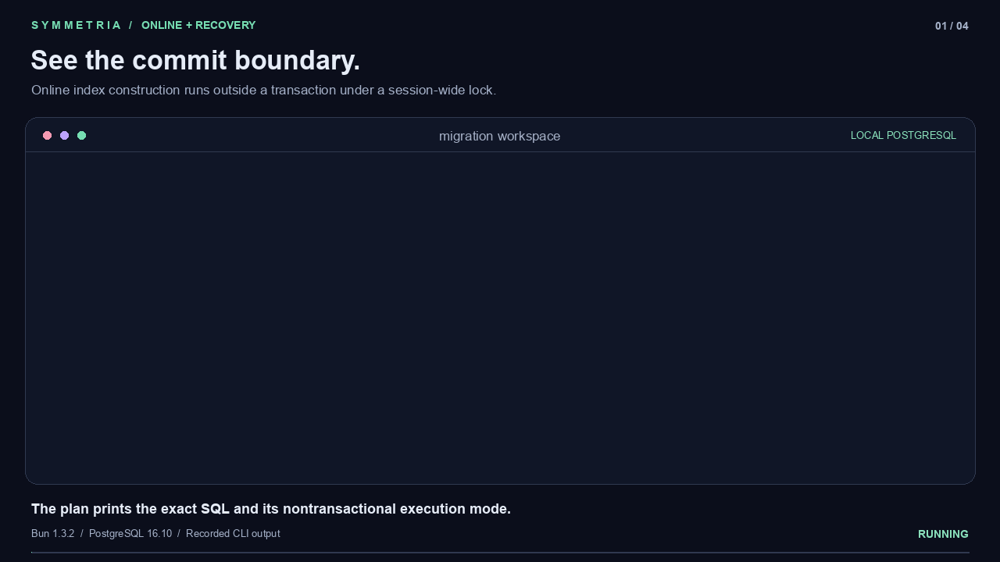
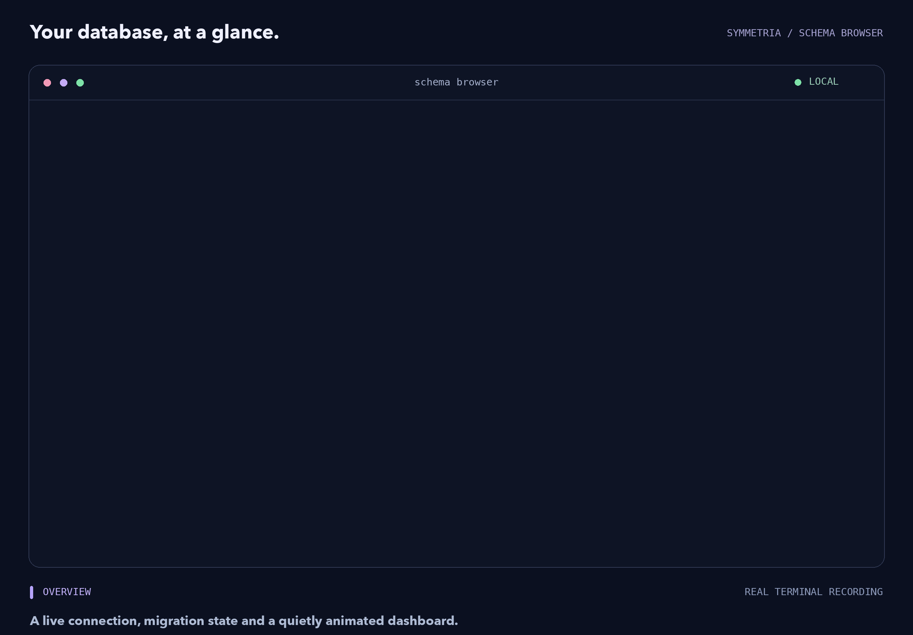
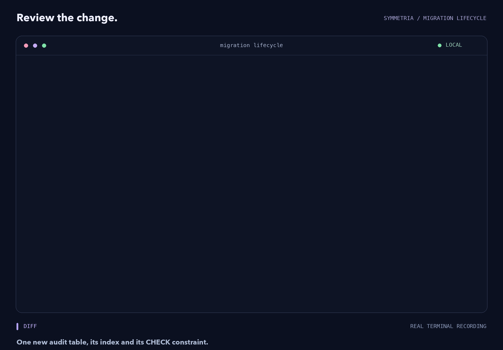
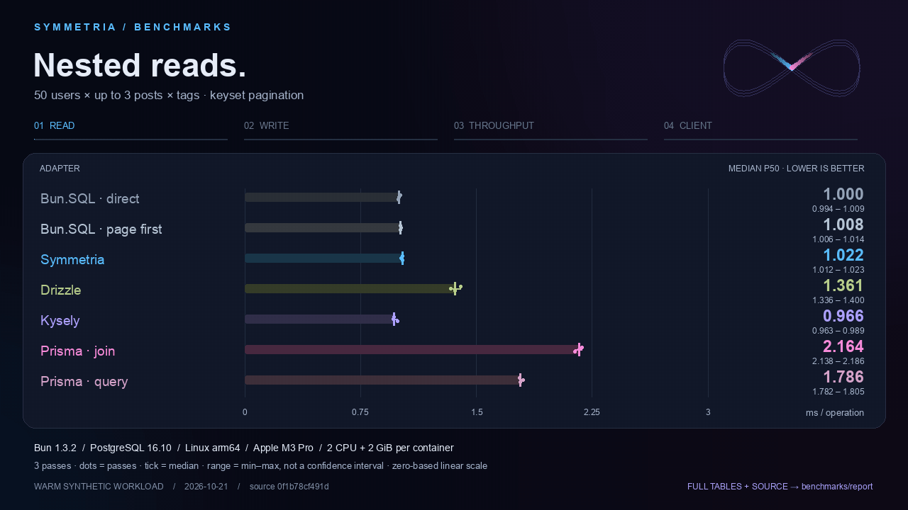

<p align="center">
  
</p>

<h1 align="center">Symmetria</h1>

<p align="center">
  <strong>Type-safe PostgreSQL. Shape-first TypeScript. Built for Bun.</strong>
</p>

<p align="center">
  <a href="#quick-start">Quick start</a> ·
  <a href="docs/guide.md">Guide</a> ·
  <a href="docs/reference.md">API reference</a> ·
  <a href="docs/advanced.md">Advanced recipes</a> ·
  <a href="examples/README.md">Examples</a> ·
   <a href="#see-your-queries">Live demo</a> ·
   <a href="#migrations-you-can-read">Migrations</a> ·
  <a href="#benchmarks">Benchmarks</a> ·
  <a href="CONTRIBUTING.md">Contributing</a>
</p>

Declare tables in TypeScript, follow relationships, and get the exact result
shape back from SQL. Ordinary keys select fields; `$` keys control the query.

```ts
const authors = await database.users((user) => ({
  name: user.name,
  posts: user.posts((post) => ({
    title: post.title,
    views: post.views,
    $orderBy: post.id.descending,
    $limit: 3,
  })),
}));
// { name: string; posts: { title: string; views: bigint }[] }[]
// One SQL statement. Three posts per author. Bigints stay bigints.
```

**Bun 1.3+ · ESM · MIT**

PostgreSQL is the primary database. An embedded
[SQLite driver](docs/reference.md#sqlite-driver) supports local tools and tests.
Both packages have zero runtime dependencies; Kit declares Symmetria as a peer
dependency.

## Why Symmetria

- **Queries follow your data.** Inferred foreign keys, automatic JOINs, nested
  collections, reusable projections and exact result types.
- **SQL stays visible.** Immutable queries, bound parameters, CTEs, windows,
  aggregates, transactions and `.toSQL()` on every ordinary query.
- **Values keep their precision.** Native bigint, decimal strings, dates and
  custom codecs, including inside nested JSON results.
- **Tools work together.** Reviewable migrations, a schema browser, query
  inspection and opt-in request profiling.

## Packages

| Package                                   | Purpose                                                       |
| ----------------------------------------- | ------------------------------------------------------------- |
| [`symmetria`](packages/runtime/README.md) | Schemas, queries, PostgreSQL/SQLite drivers and observability |
| [`symmetria-kit`](packages/kit/README.md) | Migration CLI, schema browser and interactive inspection      |

## Quick start

Install the runtime and migration tools:

```sh
bun add symmetria
bun add -d symmetria-kit
bunx --package symmetria-kit symmetria init
```

`init` creates modular tables, a connection, migration config and
`.env.example`. For a small application, the same setup can be written directly:

### 1. Define the schema

```ts
// schema.ts
import { schema, table, int, text, bigint, oneOf } from "symmetria";

const users = table({
  id: int.auto,
  name: text,
  email: text.unique,
});

const posts = table({
  id: int.auto,
  title: text,
  author: users.index,
  views: bigint.default(0n),
  state: oneOf("draft", "published").default("draft"),
});

export const appSchema = schema({ users, posts });
```

`author: users.index` defines the foreign key, its index and the relationships
`post.author` / `user.posts`. Schema declarations work offline.

### 2. Generate and apply a migration

```ts
// symmetria.config.ts
import { defineMigrationConfig } from "symmetria-kit";
import { appSchema } from "./schema";

export default defineMigrationConfig({
  schema: appSchema,
  directory: "./migrations",
  databaseUrl: process.env.DATABASE_URL,
});
```

Set `DATABASE_URL` in `.env`, then generate, review and apply the SQL:

```sh
bunx --package symmetria-kit symmetria generate initial
bunx --package symmetria-kit symmetria migrate
```

### 3. Connect and query

```ts
// main.ts — bun main.ts
import { createDatabase } from "symmetria";
import { postgres } from "symmetria/driver";
import { appSchema } from "./schema";

const database = createDatabase({
  schema: appSchema,
  driver: postgres(process.env.DATABASE_URL!),
});

try {
  await database.users
    .insert({ name: "Ada", email: "ada@example.com" })
    .onConflict("email")
    .doNothing();

  const author = await database.users.by.email("ada@example.com").one();
  await database.posts.insert({ title: "Typed SQL", authorId: author.id });

  const feed = await database.posts((post) => ({
    title: post.title,
    author: post.author.name,
    $orderBy: post.id.descending,
    $limit: 10,
  }));
  // { title: string; author: string }[]

  console.log(feed);
} finally {
  await database.$close();
}
```

The author path adds its JOIN automatically. `await query` and `.execute()` run
the query; `.toSQL()` compiles SQL and parameters without executing it.

## Compose the result

Tables, aliases, relations and CTEs share the same callable API. Save a
projection with `.shape()`, aggregate related rows, and map enum values with SQL
CASE:

```ts
const userCard = database.users.shape((user) => ({
  name: user.name,
  totalViews: user.posts.sum((post) => post.views),
}));

const feed = database.posts((post) => ({
  title: post.title,
  status: post.state.match({ draft: "Draft", published: "Published" }),
  author: post.author(userCard),
}));
const latest = feed(() => ({ $limit: 10 }));
```

Reusable projections contain fields; apply `$...` controls when using them.
Controls-only calls preserve the projection. Filters and pagination select
aggregate input rows; sums and averages return decimal strings or `null`.

| Explore                                         | Reference                                                                                                        |
| ----------------------------------------------- | ---------------------------------------------------------------------------------------------------------------- |
| Inferred JOINs, aliases and nested collections  | [Shape-first queries](docs/reference.md#shape-first-queries)                                                     |
| Reusable projections and enum CASE              | [`.shape()`](docs/reference.md#reusable-projections) · [`.match()`](docs/reference.md#enum-mappings)             |
| Relationship counts, sums, averages and extrema | [Relation aggregates](docs/reference.md#relation-aggregates)                                                     |
| Direct-row writes, upserts and nested inserts   | [Writes](docs/reference.md#insert-update-delete) · [Nested inserts](docs/reference.md#atomic-nested-inserts)     |
| Prepared queries and keyset pagination          | [Prepared queries](docs/reference.md#prepared-queries) · [Cursor pages](docs/reference.md#cursor-pages)          |
| CTEs, windows, transactions and savepoints      | [CTEs and windows](docs/reference.md#ctes-and-window-functions) · [Transactions](docs/reference.md#transactions) |

**[Complete API reference →](docs/reference.md)**

## See your queries

```ts
await query.inspect();
```

Browse SQL, parameters, decoded results and PostgreSQL query plans in your
terminal. SQL inspection also works offline. Kit loads when you open the
interactive UI.

<a href="docs/assets/query-inspector.webp">
  <picture>
    <source media="(prefers-reduced-motion: reduce)" srcset="docs/assets/query-inspector.png">
    
  </picture>
</a>

[Static preview](docs/assets/query-inspector.png) ·
[Inspector reference](docs/reference.md#query-inspector)

### Live request profiler

<a href="docs/assets/profiler.webp">
  <picture>
    <source media="(prefers-reduced-motion: reduce)" srcset="docs/assets/profiler.png">
    
  </picture>
</a>

[Static preview](docs/assets/profiler.png)

Use `createProfiler()` for per-request build, compile, database and decode
timings. [Run the live example](examples/README.md#live-profiler-demo) or read
the [inspector](docs/reference.md#query-inspector) and
[profiler](docs/reference.md#live-request-profiler) guides.

## Migrations you can read

Generate offline, review the SQL, verify it on disposable PostgreSQL databases,
then deploy with explicit execution boundaries. SQL and metadata have separate
locations:

```text
migrations/
├── 000001_initial/
│   ├── up.sql
│   └── down.sql
└── meta/
    ├── snapshot.json
    └── migration.json
```

`snapshot.json` holds the latest generated schema; `migration.json` holds the
whole migration journal. Generation updates these two files in place.

- **Controlled execution.** Atomic `batch` by default; `each` and `none` support
  separate commits and online DDL. A pinned PostgreSQL session holds the
  advisory lock across transaction boundaries.
- **Bounded operations.** Advisory-lock, DDL-lock and statement timeouts,
  cancellation, statement-level events and `migrate --plan` make deployments
  observable.
- **Verified schemas.** Drift checks defaults, identity, PK/FK/UNIQUE/CHECK
  constraints, FK actions, enum ordering and index validity. `adopt` checks the
  live schema before recording history.
- **Recoverable state.** Nontransactional failures persist as `incomplete` and
  require explicit `repair`. `recover` restores file publication after a crashed
  generator. Column declarations keep their order; snapshot hashes are
  canonical.

[Migration workflow](docs/reference.md#migrations) ·
[Execution modes and timeouts](docs/reference.md#execution-modes-timeouts-and-plans)
· [Recording source and transcripts](docs/demos/README.md)

### Generate safely. Review saved SQL.

Renames use explicit hints. Dropped tables or columns require
`--allow-destructive`. `lint` checks saved `up.sql` after generation and fails
on destructive or blocking findings; `--pending` selects unapplied migrations.

<a href="docs/assets/migration-safety.gif">
  <picture>
    <source media="(prefers-reduced-motion: reduce)" srcset="docs/assets/migration-safety.png">
    
  </picture>
</a>

[Static preview](docs/assets/migration-safety.png)

### Verify against real PostgreSQL.

`verify` exercises installation, upgrades, rollback and reapplication in
disposable databases. Data hooks assert application-specific invariants; the
verification connection needs `CREATEDB`. Live drift and verified adoption catch
manual schema changes before history is re-baselined.

<a href="docs/assets/migration-verification.gif">
  <picture>
    <source media="(prefers-reduced-motion: reduce)" srcset="docs/assets/migration-verification.png">
    
  </picture>
</a>

[Static preview](docs/assets/migration-verification.png) ·
[Verification hooks](docs/reference.md#disposable-database-verification)

### Online DDL with explicit recovery.

`generate --online` supports concurrent indexes, phased constraint validation
and additive enum changes. If a nontransactional migration fails, inspect its
durable state, reconcile the objects and data, then use `repair` to verify the
boundary before retrying or recording completion.

<a href="docs/assets/migration-recovery.gif">
  <picture>
    <source media="(prefers-reduced-motion: reduce)" srcset="docs/assets/migration-recovery.png">
    
  </picture>
</a>

[Static preview](docs/assets/migration-recovery.png) ·
[Online DDL and recovery](docs/reference.md#online-ddl-and-recovery)

These recordings use actual CLI output from PostgreSQL 16.10. Playback is paced
for readability;
[commands, exit codes and reproduction scripts](docs/demos/README.md) are
included.

### Explore your schema

<a href="docs/assets/kit-schema.webp">
  <picture>
    <source media="(prefers-reduced-motion: reduce)" srcset="docs/assets/kit-schema.png">
    
  </picture>
</a>

[Static preview](docs/assets/kit-schema.png)

### Apply and roll back a migration

<a href="docs/assets/kit-migrations.webp">
  <picture>
    <source media="(prefers-reduced-motion: reduce)" srcset="docs/assets/kit-migrations.png">
    
  </picture>
</a>

[Static preview](docs/assets/kit-migrations.png)

## Benchmarks

The [containerized benchmark suite](benchmarks/README.md) compares Symmetria,
Drizzle, Kysely, Prisma and hand-written SQL on the same PostgreSQL dataset.
Correctness is checked before timing; measured source, raw samples and SQL plans
are included with the results.

<!-- benchmark:start -->
<a href="benchmarks/report/README.md">
  <picture>
    <source media="(prefers-reduced-motion: reduce)" srcset="docs/assets/benchmarks.svg">
    
  </picture>
</a>

Bun 1.3.2 · PostgreSQL 16.10 · Linux/arm64 · Apple M3 Pro / OrbStack. 3 passes;
2 CPUs / 2 GiB per container; durable storage. Medians and full pass ranges.

[Results](benchmarks/report/README.md) · [Reproduce](benchmarks/README.md) ·
[Raw data + source](benchmarks/report/data.tar.gz) ·
[Static chart](docs/assets/benchmarks.svg)
<!-- benchmark:end -->

## Contributing

```sh
bun install --frozen-lockfile
bun run build
bun run check
bun run test
```

See [CONTRIBUTING.md](CONTRIBUTING.md) for setup, targeted builds and PostgreSQL
tests. Bug reports are most useful with a small schema, query and generated SQL.

[Test suites](tests/README.md) · [Building and publishing](docs/publishing.md) ·
[Changelog](CHANGELOG.md)

## License

[MIT](LICENSE) · Made by Mikhail Demidoff.
