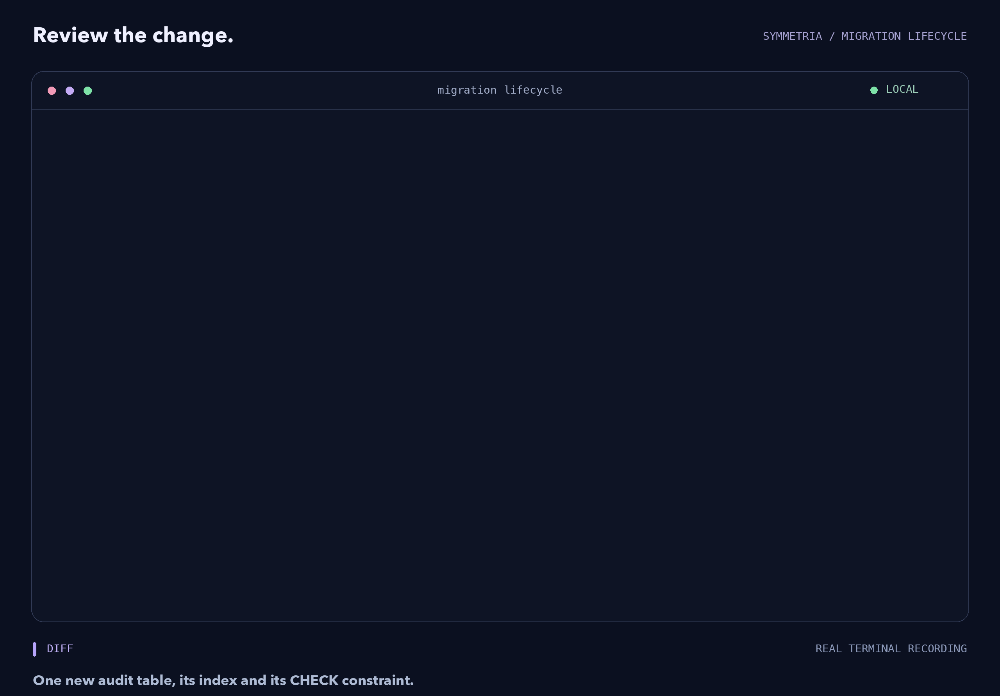
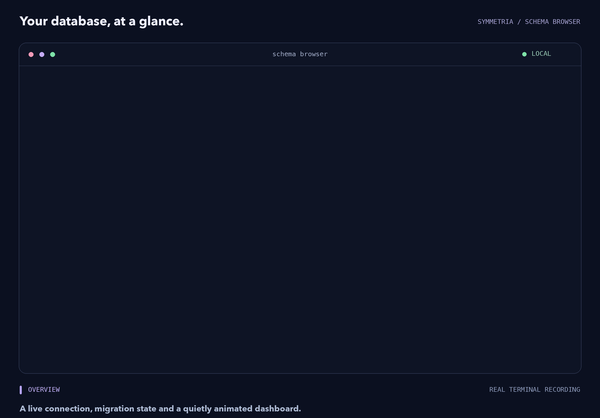
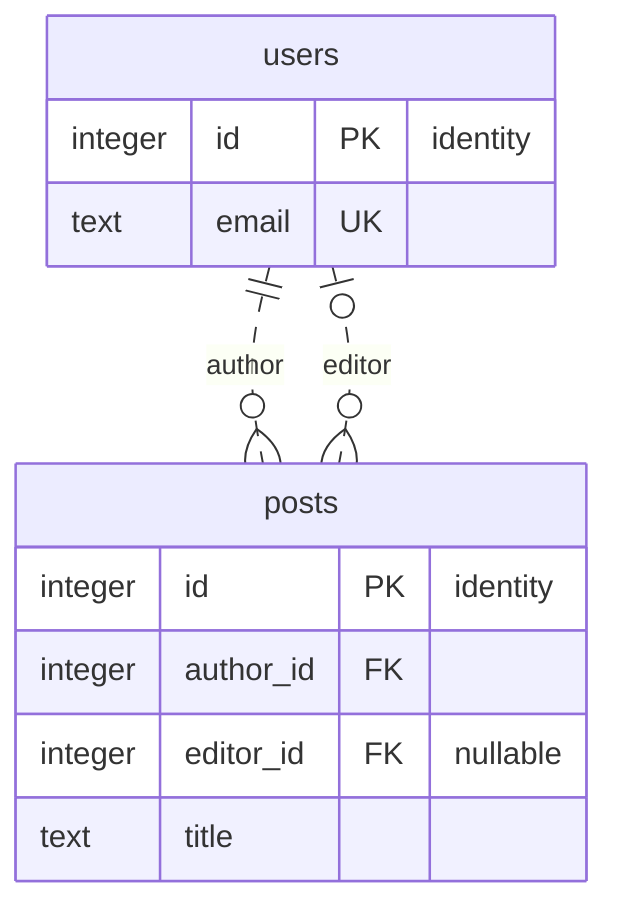
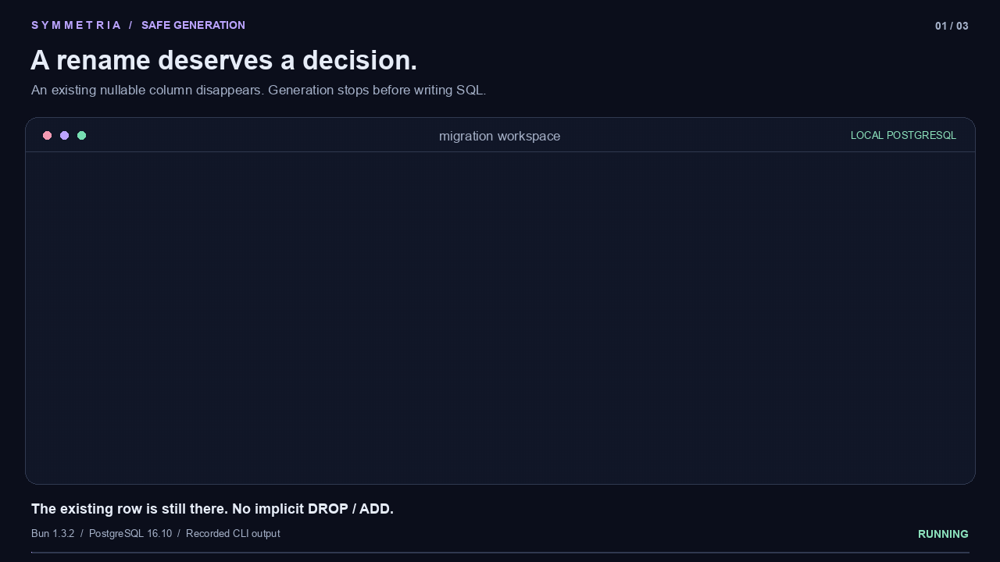
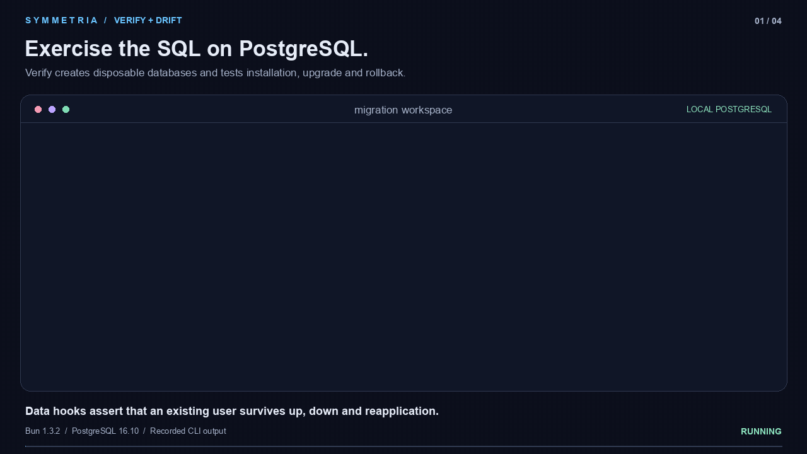
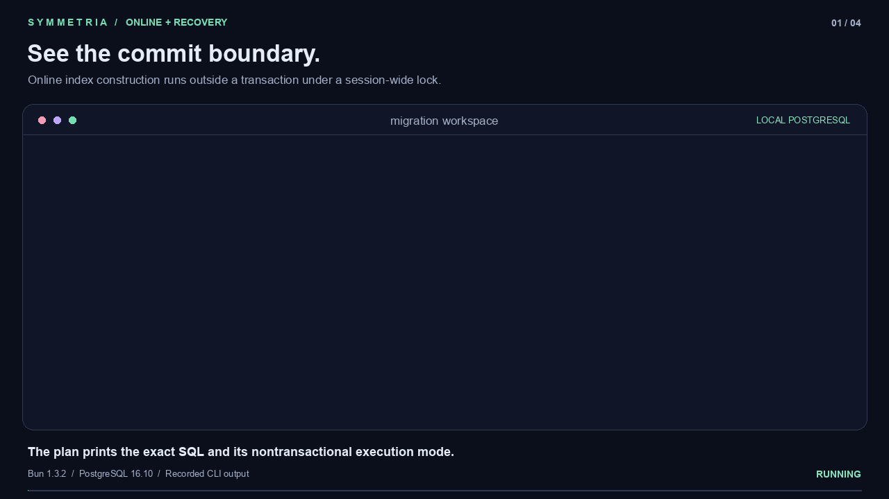
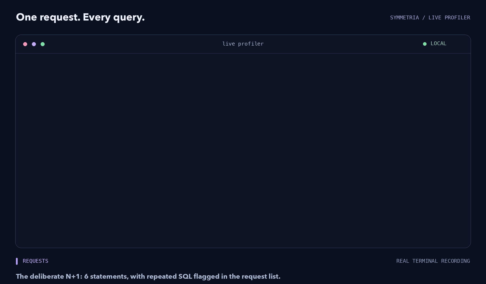
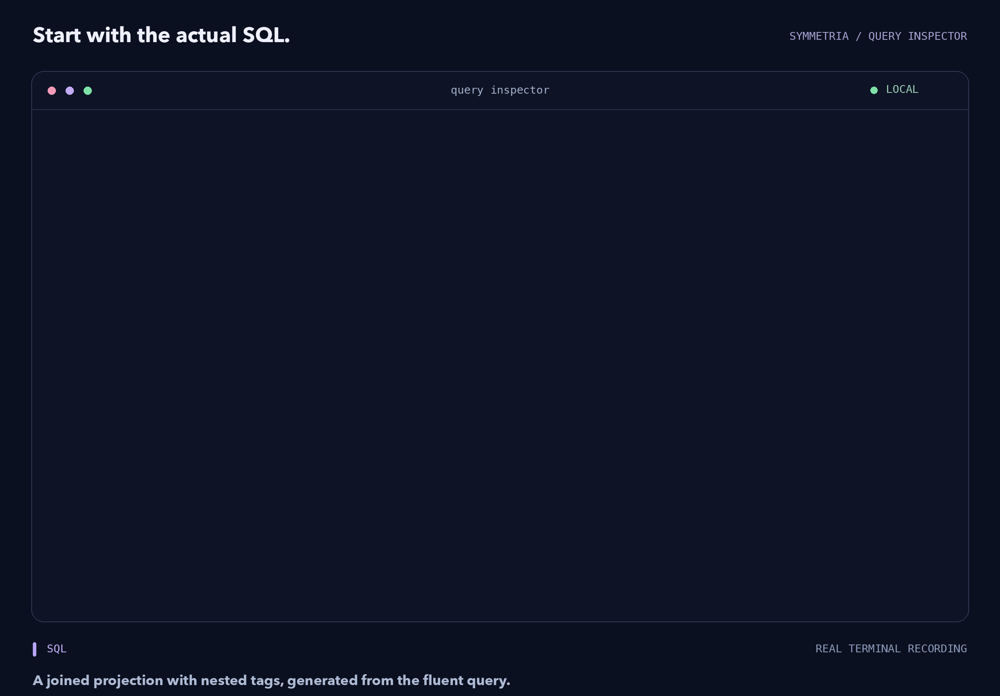

# symmetria-kit

Migration and development tools for the
[Symmetria](https://www.npmjs.com/package/symmetria) PostgreSQL query builder on
Node.js 24.11+ or Bun 1.4.4+.

```sh
bun add symmetria
bun add -d symmetria-kit
bunx --package symmetria-kit symmetria init
```

The package installs the **`symmetria`** command. Run it without arguments in a
terminal to open the dashboard. Use matching runtime and Kit versions. On
Node.js, install with npm and run `npx --package symmetria-kit symmetria`. The
CLI uses Node.js by default; `bunx --bun` selects Bun. Kit includes `pg`. The
CLI resolves extensionless relative imports in `symmetria.config.ts` on Node;
application modules that Node runs directly keep their `.ts` extensions.

```ts
// symmetria.config.ts
import { defineMigrationConfig } from "symmetria-kit";
import { appSchema } from "./src/database/schema";

export default defineMigrationConfig({
  schema: appSchema,
  directory: "./migrations",
  databaseUrl: process.env.DATABASE_URL,
});
```

<picture>
  <source media="(prefers-reduced-motion: reduce)" srcset="https://raw.githubusercontent.com/nokturnal3301/symmetria/main/docs/assets/kit-migrations.png">
  
</picture>

## Commands

| Command            | Purpose                                                             |
| ------------------ | ------------------------------------------------------------------- |
| `init [directory]` | Create missing scaffold files; preserve existing projects           |
| `pull [file]`      | Write a schema module for an existing database (default: schema.ts) |
| `graph [file]`     | Print or write a Mermaid entity-relationship diagram                |
| `inspect [table]`  | Browse columns, relations (including condition ones), indexes, SQL  |
| `diff`             | Compare source schema to the latest local snapshot                  |
| `lint`             | Check saved SQL and ungenerated changes; fail on unsafe findings    |
| `generate <name>`  | Generate migration SQL and metadata                                 |
| `migrate`          | Apply pending migrations atomically                                 |
| `status`           | Show applied/pending migrations                                     |
| `rollback`         | Revert the latest migration                                         |
| `drift`            | Compare the live database with the latest local snapshot            |
| `squash <name>`    | Collapse local migration history into a baseline                    |
| `adopt`            | Adopt a matching baseline without replaying its SQL                 |
| `profile`          | Browse live request traces and query timings                        |
| `verify`           | Test installation, upgrades and rollbacks in disposable databases   |
| `repair <id>`      | Verify and resolve an incomplete migration                          |
| `recover`          | Recover files after a crashed generator                             |

| Flag                           | Commands                                     | Purpose                                                      |
| ------------------------------ | -------------------------------------------- | ------------------------------------------------------------ |
| `--config <file>`              | all                                          | Config module (default `symmetria.config.ts`)                |
| `--dir <directory>`            | all with a project                           | Migrations directory, relative to the working directory      |
| `--database-url <url>`         | database commands, `pull`, `lint`            | Connection; overrides `databaseUrl` and `DATABASE_URL`       |
| `--json`                       | all                                          | One JSON object on stdout, `{"error": …}` on failure         |
| `--sql`                        | `diff`                                       | Print executable SQL                                         |
| `--diff <file.json>`           | `generate`, `diff`, `lint`                   | Rename hints and `USING` conversions                         |
| `--empty`                      | `generate`                                   | An empty, editable SQL migration                             |
| `--allow-destructive`          | `generate`                                   | Permit drops and narrowing type changes (`allowDestructive`) |
| `--transaction <mode>`         | `generate`                                   | `batch` (default), `each` or `none` (`transaction`)          |
| `--online`                     | `generate`, `diff`, `lint`                   | Concurrent indexes and phased validation (`online`)          |
| `--allow-custom-sql`           | `squash`                                     | Drop SQL that generate did not write (`allowCustomSQL`)      |
| `--pending`                    | `lint`                                       | Only migrations pending in the database                      |
| `--strict`                     | `lint`, `drift`                              | Exit with code 1 for any finding                             |
| `--to <id>`                    | `migrate`, `adopt`                           | Apply up to, or adopt through, a migration (`to`)            |
| `--steps <n>`                  | `rollback`                                   | Number of migrations to revert (`steps`)                     |
| `--plan`                       | `migrate`, `rollback`                        | Show SQL and transaction groups without running them         |
| `--action <action>`            | `repair`                                     | `retry` or `complete` (`action`)                             |
| `--verify-url <url>`           | `verify`, `adopt`, `repair`                  | Server for disposable databases (`verificationDatabaseUrl`)  |
| `--ignore-table <name>`        | `pull`, `drift`, `adopt`, `repair`, `verify` | Leave an undeclared table out, repeatable (`ignoreTables`)   |
| `--advisory-lock-timeout <ms>` | commands that run migrations                 | Migration lock wait (`advisoryLockTimeoutMs`, default 10000) |
| `--lock-timeout <ms>`          | commands that run migrations                 | DDL lock wait (`lockTimeoutMs`, default 5000; 0 disables)    |
| `--statement-timeout <ms>`     | commands that run migrations                 | Statement duration (`statementTimeoutMs`, default 600000)    |
| `--force`                      | `pull`, `graph`                              | Overwrite the written file                                   |
| `--compact`                    | `graph`                                      | Entities and relations without column lists                  |
| `--relations`                  | `inspect`                                    | Start on, or list, the relations                             |
| `--profile-url <url>`          | `profile`                                    | Profiler endpoint (default `http://127.0.0.1:7331`)          |
| `--profile-token <token>`      | `profile`                                    | Profiler token (default `SYMMETRIA_PROFILE_TOKEN`)           |
| `--no-interactive`             | all                                          | No dashboard, schema browser or rename questions             |
| `--no-color`, `--no-animation` | all                                          | Plain output; no logo or spinner animation                   |
| `--help`, `-h`                 | all                                          | Show the commands and flags                                  |

`--help` prints the same list. A flag of particular commands (`--sql`, `--plan`,
`--to`, `--ignore-table`, …) is refused by the others; connection, directory,
timeout and display flags are accepted everywhere. The names in parentheses are
the matching config and API options. With `--json`, every command prints one
JSON object: the result, with lists under a key (`findings`, `migrations`,
`steps`, `tables`, `requests`), or `{"error": {"message": …}}` with exit code 1.
Ctrl-C exits with 130 and SIGTERM with 143. Config paths resolve relative to the
config file. SQL lives in `migrations/<id>/`; metadata lives in
`migrations/meta/snapshot.json` and `migrations/meta/migration.json`. Commit SQL
and both JSON files together. `diff` compares snapshots, not live DB drift.

<picture>
  <source media="(prefers-reduced-motion: reduce)" srcset="https://raw.githubusercontent.com/nokturnal3301/symmetria/main/docs/assets/kit-schema.png">
  
</picture>

The snapshot holds the latest generated schema. The journal holds IDs, parents
and schema hashes for the whole chain, without historical snapshot copies.
Generation updates the same two files; migrate/rollback only change database
history and use `up.sql`/`down.sql`. `generate --json` reports the SQL and
metadata directories.

The database journal defaults to `public._symmetria_migrations`.
`metadataSchema` and `metadataTable` configure its location; migrations create a
missing journal schema transactionally. Application tables follow the
connection's `search_path`, and `drift` inspects `current_schema()`
independently of the journal.

## Schema diagrams

`symmetria graph` prints a Mermaid `erDiagram` of the declared schema (or of the
latest migration snapshot) with keys, nullable columns and relation
cardinalities; `graph docs/schema.md` writes it inside a `mermaid` fence that
GitHub renders. `--compact` leaves out column lists; `--json` returns the tables
and edges; `schemaGraph()` and `renderMermaid()` expose the same
programmatically.



## Adopting an existing database

`symmetria pull` reads the connection's `current_schema()` and writes a schema
module in the Symmetria DSL: tables and columns under any names (with
`casing: "preserve"` and `.named()` where needed), defaults, identities
(`GENERATED BY DEFAULT` as `.auto.byDefault`), collations, enums under their own
names (`oneOf(...).typeName("Role")`, shared by several columns too), foreign
keys as relations (including `ON UPDATE CASCADE`, keys to unique columns and
columns not named `*_id`, through `.by()` and `.column()`), junction tables,
primary keys, unique columns, indexes (including expression, partial, ordered,
`INCLUDE`, collated, `WITH (…)` and non-btree indexes) and CHECK constraints.
Conditions are predicates where the DSL can write them as PostgreSQL stored them
(`users.score.between(1, 10)`,
`and(users.status.is("active"), users.deletedAt.is(null))`), and `sql` text
otherwise. A schema written with the DSL, migrated and pulled back needs no
migration: `diff` and `generate` compare conditions in a normalized form, so
`above(-100)` and `> '-100'::integer` are the same check. Pulling a database
built from a pulled schema gives back the same schema. A database created by
Prisma pulls as is, and the Prisma client keeps working next to Symmetria;
`drift` then lists only what the warnings announced.

```sh
symmetria pull src/database/schema.ts --database-url "$DATABASE_URL"
```

Everything the DSL cannot express is kept as close as possible and listed for
review: constraints with non-conventional names, Prisma's `_AB_pkey` junction
keys included (with the `RENAME CONSTRAINT` that fixes them), serial columns
(with a fix that makes them `BY DEFAULT` identities continuing after the
existing rows and drops the old sequence), types without a builder such as
`money` (declared through `customType()`), multi-column unique constraints
(declared as unique indexes), unique indexes that stand in for constraints (with
the `ADD CONSTRAINT … USING INDEX` that converts them), composite or deferrable
foreign keys, and the views, materialized views and triggers the schema does not
manage. The same list is in `--json` output under `warnings`, each with a `code`
and, when one exists, a `fix`. The file is never overwritten without `--force`.

Then point `symmetria.config.ts` at the module, run `drift` until the remaining
findings are intended, generate the first migration with `generate initial` and
record it on the existing database with `adopt`. Tables Symmetria should not
manage (another service's, PostGIS `spatial_ref_sys`) go in `ignoreTables` in
the config or `--ignore-table <name>`; `pull`, `drift`, `adopt`, `repair` and
`verify` leave them out (a table the schema declares is still compared), and the
CLI always leaves Prisma's `_prisma_migrations` out of the comparisons, so it
can stay until Prisma no longer deploys.

<picture>
  <source media="(prefers-reduced-motion: reduce)" srcset="https://raw.githubusercontent.com/nokturnal3301/symmetria/main/docs/assets/migration-safety.png">
  
</picture>

## Deployment controls

- `generate` requires explicit rename hints or `--allow-destructive` for dropped
  tables/columns and for type changes that narrow existing values (a shorter
  `varchar`, fewer decimal places). A shorter string type is altered without a
  truncating cast, so PostgreSQL refuses values that do not fit instead of
  cutting them. Declared column order is preserved; snapshot hashes are
  order-independent.
- `lint` checks actual `up.sql` even after generation and fails for destructive
  or blocking findings, reviewing every action of an `ALTER TABLE` and ignoring
  comments and strings. `CHECK` and foreign keys added without `NOT VALID` are
  blocking. `--strict` also fails for cautionary findings; `--pending` selects
  unapplied migrations using database history.
- `migrate --plan --json` shows SQL and transaction groups. `batch` is the
  atomic default; a migration that adds enum labels commits before the next one
  so that it can use them, with every driver, including custom drivers that only
  run whole transactions. `generate --transaction each|none` opts into other
  boundaries; `none` needs a driver with sessions.
- Run migrations over a direct or session-pooled connection. Through a
  transaction-mode pooler (PgBouncer `pool_mode = transaction`), which a session
  lock cannot protect, the runner notices and locks each transaction with
  `pg_advisory_xact_lock` instead, and refuses `none` migrations before anything
  runs.
- `squash` refuses to drop SQL that generate did not write (seeds, views, edited
  `up.sql`) and lists it; `--allow-custom-sql` confirms.
- `--online` generates concurrent indexes, phased constraint validation and
  additive enum changes with commit boundaries. Incomplete nontransactional work
  persists in the journal and requires explicit `repair`.
- DDL lock, statement and advisory-lock timeouts are configurable.
  SIGINT/SIGTERM cancel CLI work; the API accepts an abort signal and
  statement-level events.
- `drift` checks defaults, identities, PK/FK/UNIQUE/CHECK definitions, FK
  actions, enums, indexes and validation state. `adopt` verifies the live schema
  before rewriting history, and asks for `--to` when data-only migrations make
  the baseline ambiguous.
- `verify --verify-url "$VERIFY_DATABASE_URL"` uses real disposable PostgreSQL
  databases; the connection needs `CREATEDB`. Config/API hooks add
  representative rows and assert data invariants during upgrade, rollback and
  reapplication.

<picture>
  <source media="(prefers-reduced-motion: reduce)" srcset="https://raw.githubusercontent.com/nokturnal3301/symmetria/main/docs/assets/migration-verification.png">
  
</picture>

<picture>
  <source media="(prefers-reduced-motion: reduce)" srcset="https://raw.githubusercontent.com/nokturnal3301/symmetria/main/docs/assets/migration-recovery.png">
  
</picture>

See the
[migration reference](https://github.com/nokturnal3301/symmetria/blob/main/docs/reference.md#execution-modes-timeouts-and-plans)
for timeout defaults, historical verification, online workflows and recovery.

## Profiling and inspection

Enable `createProfiler()` in the application, pass it to
`postgres({ url, profiler })`, wrap the request handler with
`profiler.fetch(handler)`, and call `await profiler.serve()`.
`symmetria profile` connects to `http://127.0.0.1:7331`; `--profile-url`
overrides it. Enter opens a request/query, `e` estimates a plan, `a` explicitly
runs ANALYZE (both shown as a plan tree), Escape goes back and `q` exits.

The loopback endpoint checks Host and browser origin and requires the server's
token on every request. Export `SYMMETRIA_PROFILE_TOKEN` for both the
application and the CLI, or pass `--profile-token` with the value returned by
`profiler.serve()`.

The runtime's `query.inspect()` loads this package for its interactive SQL,
Parameters, Results and Explain tabs. Neither inspector analyzes a query unless
requested. Offline SQL inspection works without a database.

<picture>
  <source media="(prefers-reduced-motion: reduce)" srcset="https://raw.githubusercontent.com/nokturnal3301/symmetria/main/docs/assets/profiler.png">
  
</picture>

<picture>
  <source media="(prefers-reduced-motion: reduce)" srcset="https://raw.githubusercontent.com/nokturnal3301/symmetria/main/docs/assets/query-inspector.png">
  
</picture>

## Programmatic migrations

Exports: `defineMigrationConfig`, `migrationSnapshot`, `parseMigrationSnapshot`,
`snapshotHash`, `emptySnapshot`, `createSchemaSQL`, `diffSchemas`,
`generateMigration`, `loadMigrations`, `loadMigrationState`, `squashMigrations`,
`lintMigration`, `lintMigrationSQL`, `detectDrift`, `verifyMigrations`,
`recoverMigrationFiles`, `pullSchema`, their formatting helpers, and `migrator`
with their associated types. `pullSchema({ execute, ignoreTables })` returns the
generated source, the declared tables and the review warnings without touching
the file system. `loadMigrationState` returns `{ migrations, snapshot }`; only
the current schema snapshot is stored. Generated and squashed migrations include
their new snapshot.

```ts
import { postgres } from "symmetria/driver";
import { migrator } from "symmetria-kit";

const driver = postgres({ url: process.env.DATABASE_URL! });

try {
  await migrator({ driver, directory: "./migrations" }).migrate();
} finally {
  await driver.close();
}
```

## Isolated test databases

`symmetria-kit/testing` creates a unique PostgreSQL schema, creates the declared
tables and returns a typed database. Closing it drops that schema and its data.

```ts
import { testDatabase } from "symmetria-kit/testing";
import { appSchema } from "./src/database/schema";

const fixture = await testDatabase({
  url: process.env.SYMMETRIA_TEST_DATABASE_URL!,
  schema: appSchema,
});

try {
  await fixture.database.users((user) => ({ id: user.id }));
} finally {
  await fixture.close();
}
```

[MIT](https://opensource.org/license/mit).
